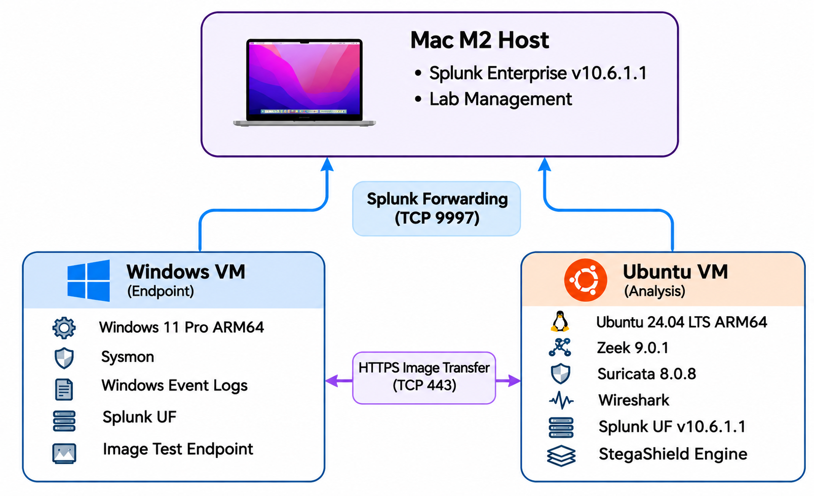

# StegaShield Detection Validation Pilot

**7 Days | Independent Detection Validation | SOC Investigation**

## Project Overview

This project documents a seven-day, evidence-driven cybersecurity research pilot evaluating StegaShield as an image steganography detection component within a controlled SOC laboratory.

The objective is to determine whether StegaShield can distinguish known clean images from genuinely steganographically modified images, investigate its detection behavior under controlled conditions, and evaluate whether its results can support SOC Tier 1 and Tier 2 investigations.

The goal is not to prove that a detection engine works. It is to establish what the evidence demonstrates, investigate unexpected findings, identify limitations, and assess operational usefulness.

This pilot is being conducted in a newly established laboratory. An earlier laboratory was retired, and no previous datasets, configurations, detection outcomes, or technical evidence are treated as valid results for this evaluation.

---

## Research Questions

The investigation addresses seven primary questions:

1. Can StegaShield distinguish known clean images from images containing genuinely embedded information?
2. How do its classification labels and probability scores differ between matching clean and modified images?
3. Under which controlled conditions do false positives and false negatives occur?
4. Are the detection results repeatable?
5. How does StegaShield behave when carrier images, payloads, or embedding methods change?
6. What evidence can Sysmon, Zeek, and Splunk provide during controlled image transfers?
7. Can StegaShield's output support a defensible SOC investigation without confusing steganography detection with proof of malicious activity or exfiltration?

The primary validation focuses on Least Significant Bit (LSB) steganography.

Tests involving techniques outside the stated primary detection scope will be documented separately as exploratory generalization testing.

---

## Laboratory Architecture

The pilot uses a Mac M2 host and two virtual machines running in a controlled laboratory environment.

The Mac hosts Splunk Enterprise for centralized monitoring and investigation.

The Windows virtual machine acts as the endpoint for controlled activity and provides Windows Event Logs and Sysmon telemetry.

The Ubuntu virtual machine supports network monitoring and is the intended environment for controlled image analysis and StegaShield deployment.

The architecture below illustrates the laboratory systems, existing monitoring components, and integrations planned for later stages of the investigation.



**Architecture note:** The diagram represents both verified infrastructure and planned functionality. Components displayed in the diagram must not be interpreted as deployed, connected, or validated unless supported by the relevant day's evidence.

### Laboratory Components

| Component | Platform | Role | Current Status |
|---|---|---|---|
| Host workstation | MacBook Air M2 | Lab management and centralized SOC investigation | Verified |
| Splunk Enterprise | macOS | Event ingestion, investigation and correlation | Verified |
| Windows VM | Windows 11 Pro ARM64 | Controlled endpoint activity | Verified |
| Sysmon | Windows | Process and network telemetry | Verified |
| Splunk Universal Forwarder | Windows | Windows telemetry forwarding | Verified |
| Ubuntu VM | Ubuntu 24.04 LTS ARM64 | Linux analysis and network sensor | Verified |
| Zeek | Ubuntu | Network connection and HTTP metadata | Verified |
| Docker | Ubuntu | Container runtime | Verified |
| Suricata | Ubuntu | Installed secondary sensor, outside primary pilot monitoring scope | Not used for primary validation |
| Wireshark | Ubuntu | Optional packet inspection and troubleshooting | Not validated for this pilot |
| Splunk Universal Forwarder | Ubuntu | Planned additional log forwarding | Not verified |
| StegaShield Engine | Ubuntu | Image steganography analysis | Not deployed |
| HTTPS Image Receiver | Ubuntu | Controlled image transfer and application inspection | Not deployed |

### Telemetry and Investigation Architecture

The verified monitoring path is:

**Windows endpoint → Sysmon → Splunk Universal Forwarder → Splunk Enterprise**

Zeek independently records network activity observed on the Ubuntu monitoring interface.

The planned Day 06 workflow will introduce controlled HTTPS image transfer, application-level image inspection, and StegaShield results for SOC correlation.

The presence of Zeek network logs does not establish visibility into encrypted HTTPS payloads or traffic that the monitored interface cannot observe.

Internal IP addresses, sensitive infrastructure identifiers, credentials, and unnecessary configuration details are intentionally excluded from this repository.

---

## Official Seven-Day Roadmap

| Day | Investigation | Objective | Status |
|---|---|---|---|
| 01 | Environment Baseline | Establish reliable infrastructure and endpoint/network telemetry | Core technical checks verified; documentation in progress |
| 02 | Dataset and Ground Truth | Establish independent clean and modified image samples | In progress |
| 03 | StegaShield Deployment and Clean Baseline | Deploy the detector and record clean-image behavior | Not started |
| 04 | LSB Detection Validation | Evaluate genuine LSB-modified image carriers | Not started |
| 05 | Error Analysis and Generalization | Investigate incorrect classifications and limitations | Not started |
| 06 | HTTPS and SOC Correlation | Investigate controlled image transfers and correlate evidence | Not started |
| 07 | Final Report and Reproducibility | Consolidate results and provide a defensible technical assessment | Not started |

---

## Day 01 — Environment Baseline

### Objective

Establish the laboratory's actual operating state before introducing detection experiments.

This includes identifying the available systems, validating connectivity, inspecting monitoring components, and determining whether meaningful endpoint and network evidence can be collected.

### Investigation Scope

- Host and virtual machine inventory
- Operating system and resource checks
- Network connectivity
- Existing services and configurations
- Sysmon process telemetry
- Sysmon network connection telemetry
- Splunk Universal Forwarder ingestion
- Splunk Enterprise searches
- Zeek service and configuration
- Zeek connection and HTTP logging
- Docker runtime readiness
- Observed limitations and remediation

### Verified Findings

The new laboratory investigation established that:

- The Windows and Ubuntu virtual machines were operational.
- The required systems could communicate over the tested network paths.
- Splunk Enterprise was operational and receiving Windows telemetry.
- Sysmon process creation and termination events were available.
- Sysmon Event ID 3 was initially absent despite network monitoring being reported as enabled.
- The installed Sysmon driver was verified running and validly signed.
- A controlled XML configuration was prepared, validated, and applied.
- Event ID 3 subsequently appeared in the local Sysmon Operational log.
- Event ID 3 was successfully forwarded and searched in Splunk.
- A final Splunk search confirmed Events 1, 3, 5, and 16.
- Zeek recorded actual network connections and HTTP request metadata.
- Docker was installed and operational.

### Sysmon Investigation Outcome

The absence of Sysmon Event ID 3 was investigated as an endpoint telemetry gap.

The investigation distinguished successful network connectivity from actual event generation.

Following the application of an explicit Sysmon configuration, network connection events became observable locally and in Splunk.

A final verification returned:

| Event ID | Description | Events Observed |
|---|---|---:|
| 1 | Process creation | 215 |
| 3 | Network connection | 52 |
| 5 | Process termination | 217 |
| 16 | Configuration change | 1 |

These counts represent the observed 30-minute Splunk search window and are not permanent system totals.

**Disposition:** Event ID 3 collection gap resolved.

The precise root cause of the original missing network telemetry remains unconfirmed.

Detailed commands, observations, troubleshooting, and evidence will be maintained in the Day 01 documentation.

---

## Day 02 — Dataset and Ground Truth

### Objective

Prepare independently verifiable image samples before evaluating StegaShield.

The dataset methodology separates reference material from independently generated validation samples.

### Dataset A — Reference Dataset

Reference material identified during earlier project planning is:

https://www.kaggle.com/datasets/marcozuppelli/stegoimagesdataset/data

The dataset has been recorded as associated with the product team's training and testing context.

Its current contents, provenance, and suitability must be verified before use in this new laboratory.

Because potential overlap with model development cannot be excluded, reference-dataset results alone will not be treated as proof of independent generalization.

### Dataset B — Independent Validation

The independent dataset is constructed from scratch in the current laboratory.

The intended structure is:

```text
dataset-b-independent/
├── clean/
├── modified/
├── scripts/
└── evidence/
```

These four directories have been created and verified in the new Ubuntu environment.

The dataset will include:

- Original known clean images
- Corresponding genuinely LSB-modified images
- Benign controlled payloads
- Generation and embedding scripts
- Independent ground-truth labels
- Image metadata and sample identifiers
- SHA256 hashes
- Reproduction checks
- An evidence manifest

The clean originals will be preserved without modification.

Labels will be established independently of the detection engine.

### Current Status

The workspace is ready.

No clean or modified images have yet been verified in the current laboratory.

The next technical checkpoint is Python Pillow dependency verification.

---

## Day 03 — StegaShield Deployment and Clean Baseline

### Objective

Establish a functioning StegaShield service and document its behavior against independently known clean images.

### Planned Activities

- Verify deployment documentation
- Confirm platform architecture compatibility
- Review resource requirements
- Record the tested product version
- Deploy the service
- Verify container or service health
- Confirm API functionality
- Validate supported image formats
- Submit known clean controls
- Record actual probability scores and classifications
- Investigate unexpected behavior

### Required Evidence

Each clean-image test will record its sample identifier, ground truth, hash, actual model response, timestamp, and relevant configuration.

No results have yet been collected for this stage.

---

## Day 04 — LSB Detection Validation

### Objective

Determine how StegaShield responds to genuinely LSB-modified carriers.

### Planned Activities

- Verify controlled embedding results
- Submit modified image samples
- Compare each carrier against its clean original
- Record probability scores and classifications
- Compare observed results with independent ground truth
- Investigate missed detections and unexpected alerts
- Preserve reproducibility evidence

A detection result will not automatically be interpreted as evidence of malicious intent.

---

## Day 05 — Error Analysis and Generalization

### Objective

Investigate classification errors, detection consistency, and limitations under controlled variations.

### Planned Activities

- Identify false positives and false negatives
- Examine threshold behavior
- Repeat selected tests
- Investigate carrier differences
- Evaluate payload variations
- Conduct limited exploratory generalization testing
- Record unexpected results and limitations

The primary LSB validation will remain separate from techniques outside the detector's stated scope.

Small laboratory samples will not be presented as evidence of production-grade accuracy.

---

## Day 06 — HTTPS and SOC Correlation

### Objective

Determine how endpoint, network, application, and detector evidence can support an investigation of controlled image transfers.

### Planned Activities

- Prepare an authorized HTTPS receiving application
- Generate controlled transfers from the Windows endpoint
- Inspect available Sysmon process and network telemetry
- Review Zeek network metadata
- Record receiver-side image handling
- Submit authorized received images to StegaShield
- Correlate available evidence in Splunk
- Build investigation timelines
- Record analyst dispositions and evidence gaps

### Operational Limitations

Encrypted HTTPS image contents are not ordinarily available to Zeek without authorized decryption.

The receiver application will provide a controlled inspection point after TLS termination.

A network connection does not prove image transfer.

An image transfer does not prove steganography.

A steganography classification does not prove data exfiltration.

Each claim must be supported independently.

---

## Day 07 — Final Report and Reproducibility

### Objective

Consolidate findings into an evidence-supported technical evaluation.

### Planned Deliverables

- Executive summary
- Research methodology
- Laboratory architecture
- Environment baseline
- Dataset provenance and ground truth
- Product deployment findings
- Clean-image scoring results
- LSB detection results
- Error analysis
- Repeatability observations
- Generalization limitations
- HTTPS investigation evidence
- Endpoint and network correlation
- SOC investigation conclusions
- Reproducibility instructions
- Recommendations and unresolved limitations

A meaningful result may be a confirmed detection, an incorrect classification, inconsistent behavior, or a documented visibility limitation.

The quality of the research depends on reproducibility and accurate interpretation, not on producing favorable detector results.

---

## Investigation Methodology

Each experiment follows the same structured process:

1. Baseline
2. Controlled Activity
3. Expected Telemetry
4. Actual Telemetry
5. Hypothesis
6. Triage
7. Investigation
8. Correlation
9. Interpretation
10. Evidence Gaps
11. Disposition
12. Detection Review
13. Tuning
14. Variation
15. Repeat

The stages are applied where relevant to each experiment.

### Investigation Principles

**Ground truth is not the model's prediction.**

**Connectivity is not proof of file transfer.**

**File transfer is not proof of steganography.**

**Steganography detection is not proof of malicious activity.**

**A detection outside the stated training scope does not establish general steganography detection capability.**

Observed evidence, interpretation, and unverified assumptions must remain separate.

---

## Repository Structure

The entire seven-day pilot is documented in one GitHub repository.

```text
stegashield-detection-validation-pilot/
├── README.md
├── assets/
│   └── lab-architecture.png
├── day-01-environment-baseline/
│   ├── README.md
│   ├── investigation-notes.md
│   └── evidence/
├── day-02-dataset-ground-truth/
│   ├── README.md
│   ├── investigation-notes.md
│   └── evidence/
├── day-03-stegashield-clean-baseline/
│   ├── README.md
│   ├── investigation-notes.md
│   └── evidence/
├── day-04-lsb-validation/
│   ├── README.md
│   ├── investigation-notes.md
│   └── evidence/
├── day-05-error-analysis/
│   ├── README.md
│   ├── investigation-notes.md
│   └── evidence/
├── day-06-https-soc-correlation/
│   ├── README.md
│   ├── investigation-notes.md
│   └── evidence/
└── day-07-final-report/
    ├── README.md
    ├── investigation-notes.md
    └── evidence/
```

This structure is the planned repository organization. Folders and artifacts are added progressively as their corresponding work is completed.

---

## Evidence and Documentation Standards

Every day will include:

- Technical README
- Investigation notes
- Genuine laboratory screenshots
- Actual commands and observations where appropriate
- Verification results
- Configuration changes
- Expected versus observed behavior
- Evidence gaps
- Supported conclusions
- Next actions

Only evidence collected in the current laboratory counts toward pilot completion.

Evidence from the retired laboratory will not be presented as current findings.

No screenshots, alerts, model scores, test results, or operational claims will be fabricated.

### Privacy and Disclosure

Public-facing documentation will exclude:

- Internal IP addresses and network identifiers
- Authentication tokens, API keys, and credentials
- Sensitive host-specific configuration details
- Unnecessary usernames and personal information
- Confidential product or team materials

Evidence screenshots will be reviewed and sanitized before any public release.

The repository will remain private during active pilot development.

---

## Current Project Checkpoint

### Day 01

Core laboratory infrastructure and telemetry verification completed.

The missing Sysmon Event ID 3 was investigated and its collection successfully restored.

Detailed Day 01 documentation is being prepared.

### Day 02

The independent dataset workspace has been created and verified.

Python Pillow dependency verification is pending.

No clean or modified image samples have yet been generated and verified in the new laboratory.

### Days 03–07

Not started.

---

## Final Goal

Produce a defensible, reproducible assessment of StegaShield's image-steganography detection behavior and its potential usefulness in a SOC investigation workflow.

The project will evaluate what was actually demonstrated, distinguish it from assumptions, and preserve both successful and unsuccessful findings.

**Seven Days. One Laboratory. Independent Evidence.**

